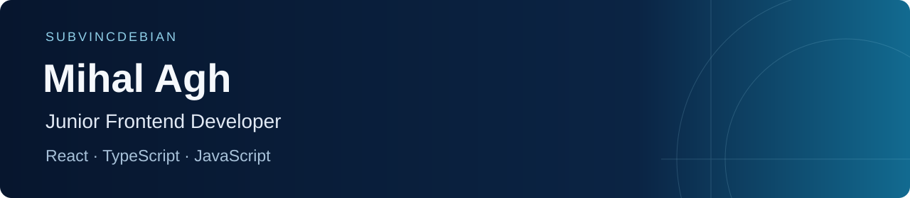

**Junior Frontend Developer · React · TypeScript · JavaScript**

I build responsive interfaces, reusable components and API integrations. My experience includes client work on **Genyxo** and co-founding **Eternal**, a team social-network project.

**Open to work:** full-time, part-time and contract. Remote first; also open to hybrid work in Kyiv.

[LinkedIn](https://www.linkedin.com/in/mihal-ag/) · [Email](mailto:aghmichal68@gmail.com) · [Telegram](https://t.me/gmblessed)

## Selected projects

### [Genyxo](https://github.com/subvincdebian/Genyxo) — client AI platform

- Built the backend and most of the frontend, with occasional frontend help from another developer.
- Worked on two redesigns, mobile layouts, chat interactions, localization and API error handling.
- Current frontend: React, TypeScript and Next.js. The migration to Next.js and complex integrations involved AI-assisted development.

[Website](https://genyxo.com) · [Frontend source](https://github.com/subvincdebian/Genyxo/tree/master/apps/web) · [Setup](https://github.com/subvincdebian/Genyxo#local-development)

### [Eternal](https://github.com/rakuzan-knu/Eternal) — team social network

- Co-founder and developer; the project started with three developers.
- Worked on React/TypeScript UI, responsive layouts, loading states, shared components and keyboard interaction.
- Stack: React, Vite, Tailwind CSS, TanStack Query and Zustand; NestJS backend. Advanced platform features also involved AI assistance.

[Website](https://eternalnet.vercel.app) · [Frontend source](https://github.com/rakuzan-knu/Eternal/tree/main/apps/web) · [Project overview](https://github.com/rakuzan-knu/Eternal#readme)

### More frontend work

| Project | What to explore |
| --- | --- |
| [VIRaTeC](https://github.com/rakuzan-knu/VIRaTeC) | Bilingual KNU research-community platform: project and publication directories, member profiles and account flows. React + TypeScript. |
| [Syntaxis](https://github.com/rakuzan-knu/Syntaxis) | Bilingual web-studio site with interactive UI demos and a project brief composer. React + TypeScript. Demo flows are simulated. |

## Stack

**Frontend:** React, TypeScript, JavaScript, HTML, CSS, Tailwind CSS, REST APIs.

**Additional project experience:** NestJS, Node.js, MySQL, PostgreSQL, Redis, Docker and Git.

Information Systems and Technologies student at **Taras Shevchenko National University of Kyiv**.

For a junior frontend opportunity or a small web project, [message me on LinkedIn](https://www.linkedin.com/in/mihal-ag/) or [email me](mailto:aghmichal68@gmail.com).
